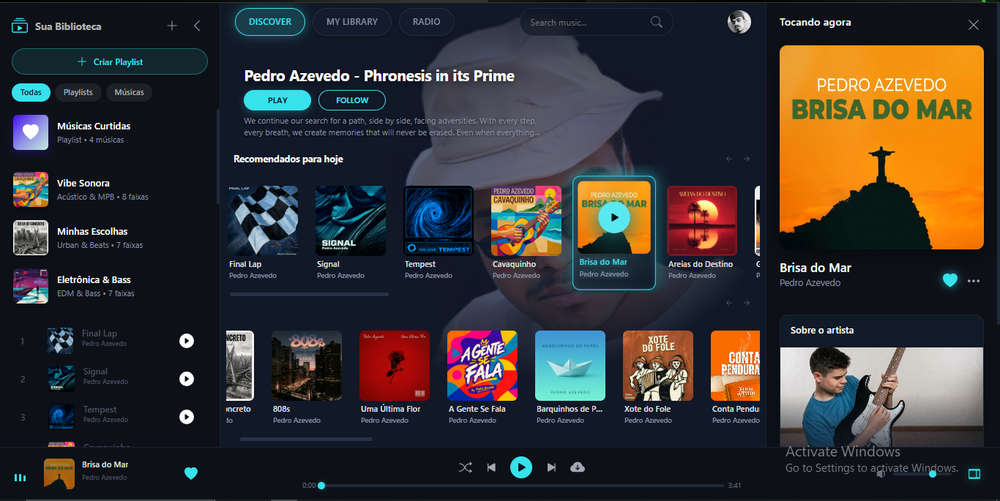
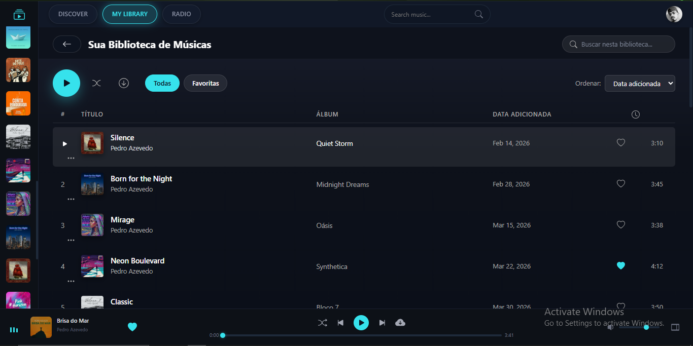
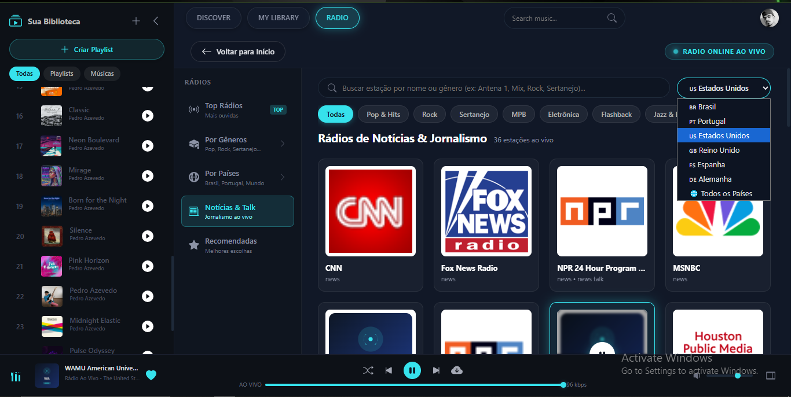
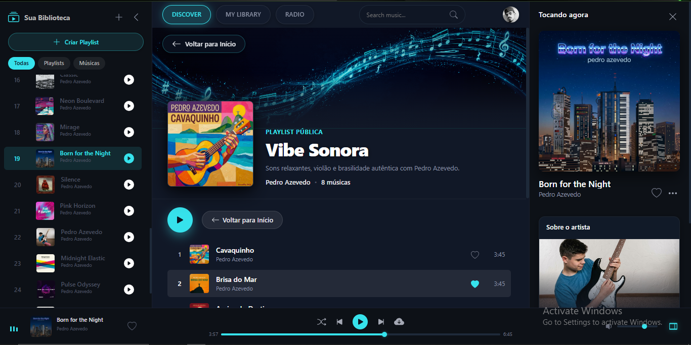

<p align="center">
  
</p>

<h1 align="center">🎵 Pedroxious Music</h1>

<p align="center">
  <strong>Plataforma de streaming musical desenvolvida por Pedro Azevedo, apresentando músicas exclusivas compostas e produzidas pelo artista.</strong>
</p>

<p align="center">
  
  
  
  
</p>

<p align="center">
  
  
  
  
</p>

---

## 📖 Sobre o Projeto

O **Pedroxious Music** é uma aplicação web completa de streaming musical, construída inteiramente com tecnologias front-end nativas (**HTML5**, **CSS3** e **JavaScript Vanilla**), sem dependências de frameworks ou bibliotecas externas. A plataforma foi projetada para oferecer uma experiência premium de reprodução musical, com interface moderna inspirada nos principais serviços de streaming do mercado.

Todas as faixas disponíveis na plataforma são **composições originais de Pedro Azevedo**, abrangendo gêneros como MPB, Acústico, EDM, Urban Beats e Eletrônica, refletindo a versatilidade artística do autor.

---

## 🖥️ Capturas de Tela

### Página Discover — Visão Geral

<p align="center">
  
</p>

> Interface principal da aplicação exibindo o layout completo com três painéis: **sidebar esquerda** com a biblioteca do usuário (playlists categorizadas por gênero e filtros de navegação), **área central** com carrosséis horizontais de álbuns organizados por recomendações e lista de faixas enumeradas com controles individuais de reprodução, e **sidebar direita** com o painel "Tocando agora" apresentando a capa do álbum em destaque, informações da faixa atual e seção do perfil do artista. Na parte inferior, o **player persistente** com barra de progresso, controles de reprodução (shuffle, anterior, play/pause, próxima) e indicador de duração.

---

### Biblioteca de Músicas — My Library

<p align="center">
  
</p>

> Seção **My Library** apresentando a biblioteca pessoal do usuário em formato de listagem tabular. Cada faixa é exibida com miniatura do álbum, título, artista, nome do álbum, data de adição e duração. Inclui filtros de visualização (**Todas** / **Favoritas**), ordenação por data de adição e barra de busca interna para filtragem rápida dentro da biblioteca. A sidebar esquerda permanece no modo compacto, exibindo apenas as capas dos álbuns para maximizar o espaço da área de conteúdo.

---

### Rádio Online — Estações ao Vivo

<p align="center">
  
</p>

> Módulo de **Rádio Online ao Vivo** com integração a estações de rádio reais via streaming. A interface apresenta navegação por categorias (**Top Rádios**, **Por Gêneros**, **Por Países**, **Notícias & Talk**, **Recomendadas**), filtros por gênero musical (Pop & Hits, Rock, Sertanejo, MPB, Eletrônica, Flashback, Jazz & Blues), seletor de país com suporte a múltiplas regiões (Brasil, Portugal, Estados Unidos, Reino Unido, Espanha, Alemanha) e campo de busca por nome ou gênero de estação. O player inferior adapta-se para exibir o indicador **"AO VIVO"** com taxa de bitrate em tempo real.

---

### Página de Playlist — Detalhes e Reprodução

<p align="center">
  
</p>

> Visualização detalhada de uma **playlist personalizada** ("Vibe Sonora"), apresentando banner decorativo com notas musicais, capa do álbum em destaque, metadados da playlist (tipo, nome, descrição, autor e contagem de músicas), e listagem das faixas com controles individuais de reprodução, sistema de favoritos e exibição de duração. O painel lateral direito exibe o player "Tocando agora" com a capa da faixa em reprodução e informações do artista.

---

## ✨ Funcionalidades

| Categoria | Funcionalidades |
|---|---|
| **Player de Música** | Reprodução com play/pause, avançar/retroceder, barra de progresso interativa, controle de volume, modos shuffle e repeat |
| **Biblioteca** | Visualização em lista tabular, filtros (Todas/Favoritas), ordenação por data, busca interna |
| **Playlists** | Criação personalizada com nome, descrição e upload de imagem de capa, exclusão dinâmica sem recarregamento |
| **Sistema de Pastas** | Organização de álbuns em pastas na sidebar, com limite de 10 álbuns por pasta |
| **Fila de Reprodução** | Gerenciamento de fila com adição de álbuns inteiros para reprodução sequencial |
| **Busca Inteligente** | Barra de pesquisa com expansão animada, sugestões em tempo real e reprodução direta ao selecionar |
| **Rádio Online** | Streaming ao vivo de estações reais, filtros por gênero/país, indicador de bitrate |
| **Menus Contextuais** | Menus personalizados via clique direito em álbuns e sidebar, substituindo o menu padrão do navegador |
| **Favoritos** | Sistema de curtidas por faixa com persistência via localStorage |
| **Sidebar Dinâmica** | Navegação lateral com filtros (Todas, Playlists, Músicas), modo compacto e completo |
| **Painel "Tocando Agora"** | Sidebar direita com capa ampliada, informações da faixa e perfil do artista |

---

## 🛠️ Tecnologias Utilizadas

| Tecnologia | Aplicação |
|---|---|
| **HTML5** | Estrutura semântica da aplicação, elementos de áudio (`<audio>`) |
| **CSS3** | Estilização completa com variáveis CSS, glassmorphism, animações, gradientes e layout responsivo |
| **JavaScript (ES6+)** | Lógica de reprodução, manipulação do DOM, gerenciamento de estado, event delegation e localStorage |
| **Web Audio API** | Controle avançado de reprodução de áudio nativo do navegador |
| **LocalStorage API** | Persistência de dados do usuário (playlists, favoritos, pastas, fila de reprodução) |

---

## 📁 Estrutura do Projeto

```
Pedroxious-Music/
├── index.html          # Página principal da aplicação
├── style.css           # Estilos globais (5500+ linhas)
├── app.js              # Lógica da aplicação (3000+ linhas)
├── LICENSE             # Licença proprietária
├── README.md           # Documentação do projeto
├── img/                # Capas de álbuns, ícones e assets visuais
│   ├── MusicalNote.png # Banner principal
│   ├── PedroAzevedo.jpg
│   └── ...             # 60+ imagens de álbuns
├── Music/              # Faixas de áudio em formato MP3
│   ├── Brisa do Mar.mp3
│   ├── Cavaquinho.mp3
│   └── ...             # 22 faixas originais
└── media/              # Screenshots da aplicação
    ├── 01.png          # Página Discover
    ├── 02.png          # Biblioteca (My Library)
    ├── 03.png          # Rádio Online
    └── 04.png          # Página de Playlist
```

---

## 🚀 Executando Localmente

```bash
# Clone o repositório
git clone https://github.com/Pedroxious/Pedroxious-Music.git

# Acesse o diretório do projeto
cd Pedroxious-Music

# Abra o arquivo principal no navegador
start index.html
```

> **Nota:** Por se tratar de uma aplicação puramente front-end, não são necessárias instalações de dependências ou servidores. Basta abrir o `index.html` em qualquer navegador moderno.

---

## 🎨 Design

A interface segue uma paleta de cores escura com acentos em **ciano/turquesa (`#36e2ec`)**, aplicando técnicas modernas de UI como:

- **Glassmorphism** — Painéis com `backdrop-filter: blur()` e bordas translúcidas
- **Micro-animações** — Transições suaves em hovers, expansões e menus contextuais
- **Layout de três painéis** — Sidebar esquerda + conteúdo central + sidebar direita
- **Player persistente** — Barra fixa no rodapé com controles sempre acessíveis

---

## 👤 Autor

<table>
  <tr>
    <td align="center">
      <a href="https://github.com/Pedroxious">
        <br />
        <sub><b>Pedro Azevedo</b></sub>
      </a><br />
      <sub>Desenvolvedor & Compositor</sub>
    </td>
  </tr>
</table>

---

## 📄 Licença

Este projeto é de propriedade exclusiva do autor. **Todos os direitos reservados.**

O código-fonte, assets visuais e faixas musicais não podem ser reproduzidos, distribuídos ou utilizados sem autorização prévia por escrito. Consulte o arquivo [LICENSE](LICENSE) para mais detalhes.

---

<p align="center">
  Feito com ❤️ e 🎸 por <a href="https://github.com/Pedroxious">Pedro Azevedo</a>
</p>
